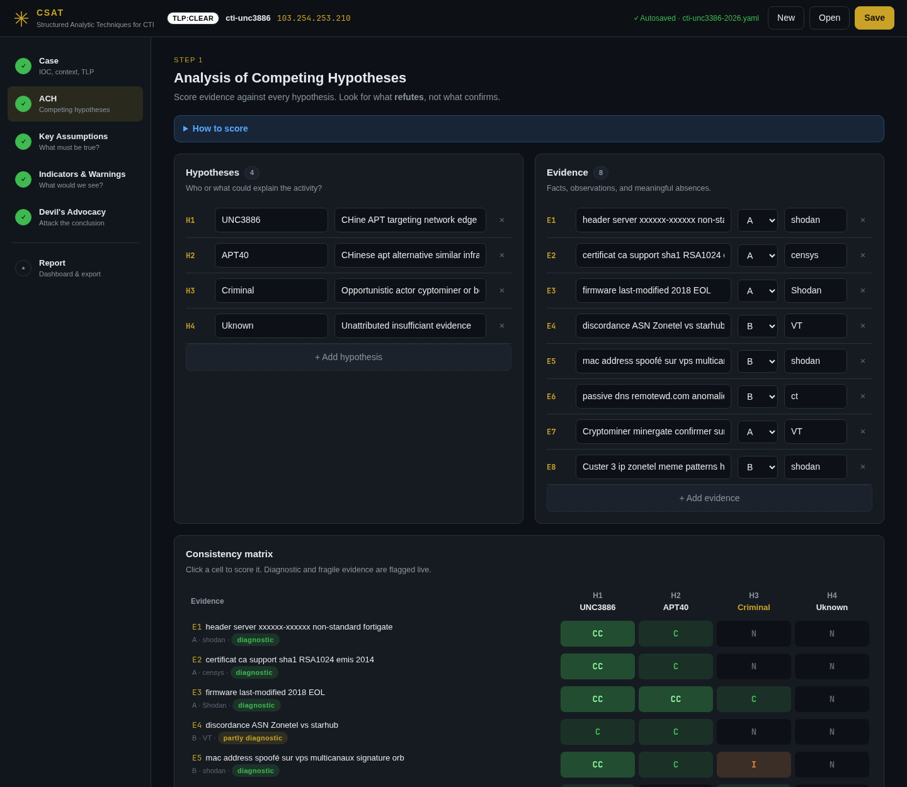
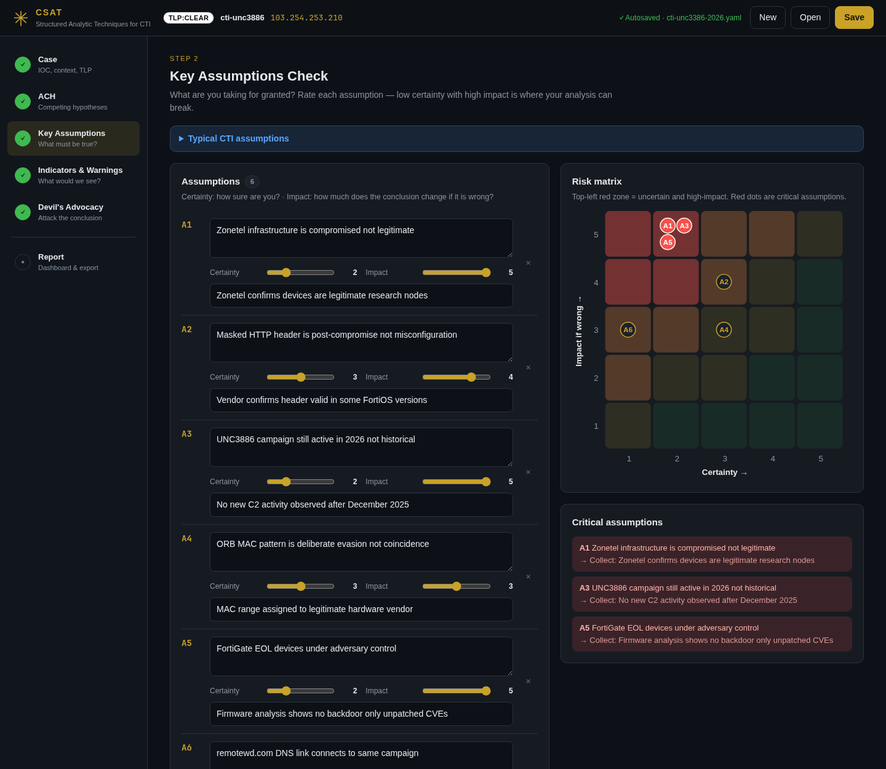
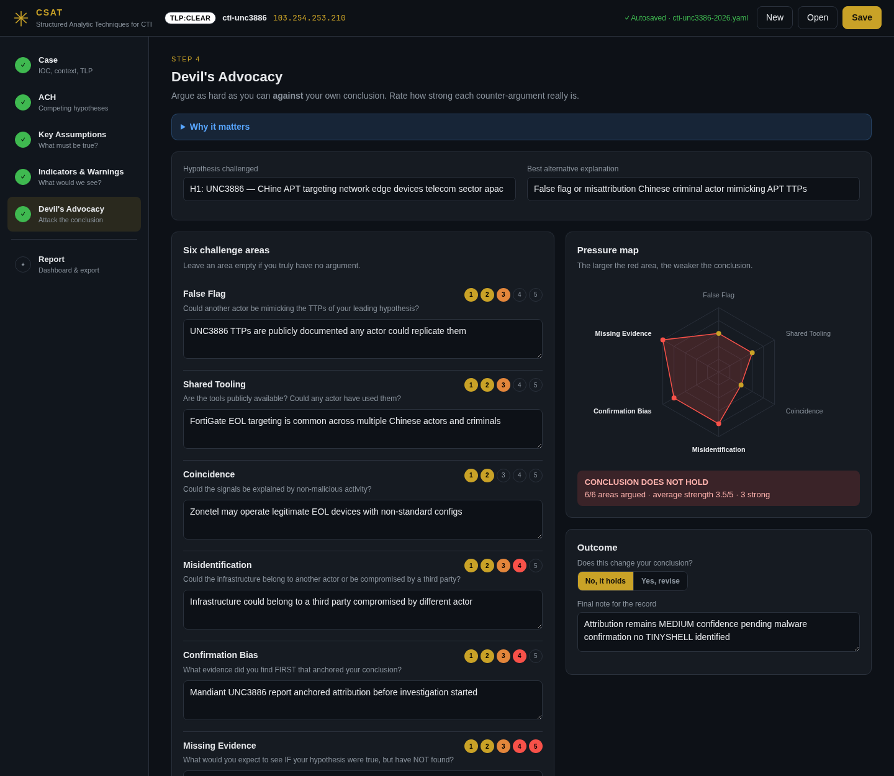
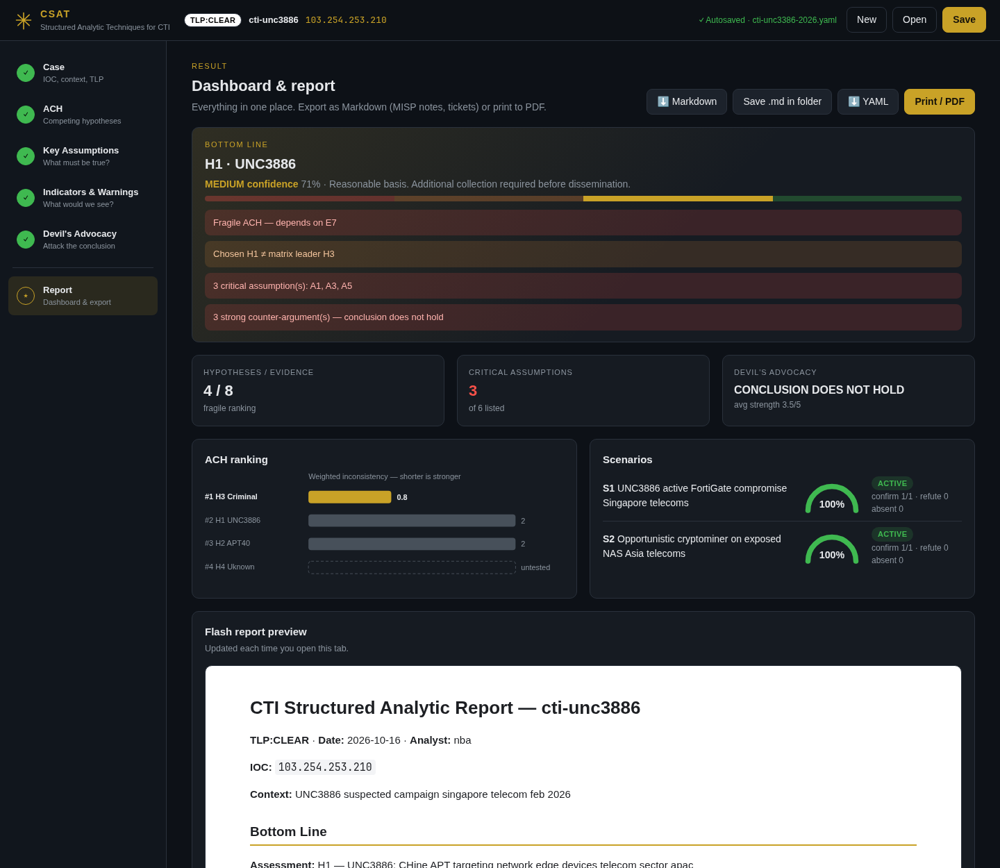

# CSAT: CTI Structured Analytic Techniques

A local, graphical tool to run structured analytic techniques on cyber threat intelligence cases: IOC investigations, attribution assessments, campaign analysis. It guides you through four techniques, scores your reasoning live and produces a Flash Report ready for MISP or a ticket.



---

## Quick start

```bash
pip install pyyaml                 # Arch: sudo pacman -S python-yaml
python csat.py                     # opens the interface in your browser
python csat.py my_case.yaml        # open an existing session
```

No account or configuration needed. The tool runs a small local server on `127.0.0.1`, stop it with `Ctrl+C`. Sessions are plain YAML files in the folder you launched from, **autosaved** after the first save.

Requirements: Python 3.8+ and PyYAML.

---

## Workflow

| Step | Technique | What you do | What the tool shows |
|---|---|---|---|
| 0 | **Case** | IOC, context, TLP | - |
| 1 | **ACH**: Analysis of Competing Hypotheses | List hypotheses and evidence, click cells to score (CC / C / N / I / II) | Ranking, diagnostic evidence, fragile evidence, untested hypotheses |
| 2 | **KAC**: Key Assumptions Check | Write assumptions, slide certainty and impact | Risk matrix, critical assumptions → collection priorities |
| 3 | **I&W**: Indicators & Warnings | Define confirm / refute / monitor indicators, tick what you observed | Gauge and status per scenario |
| 4 | **DA**: Devil's Advocacy | Argue against your conclusion on six fronts, rate each argument | Pressure radar, verdict |
| ★ | **Report** | - | Bottom line with every open warning, Markdown / YAML export, print to PDF |

Each step has a collapsible guide explaining the method in plain words.





---

## How scoring works

### ACH

Following Heuer, the leading hypothesis is the one with the **least evidence against it**, not the most evidence for it.

- Each inconsistent cell counts against the hypothesis: `I` = 1, `II` = 2.
- It is weighted by source reliability: **A** 1.0 · **B** 0.8 · **C** 0.6 · **D** 0.4. A single unconfirmed report cannot eliminate a hypothesis on its own.
- Ties are broken by weighted net consistency.
- A hypothesis scored only `N` is flagged **untested** and cannot lead: it has nothing against it only because it was never tested.
- **Sensitivity:** each evidence item is removed in turn. If the leader changes, the conclusion is **fragile** and the item is highlighted.
- **Diagnosticity:** an item scored the same for every hypothesis has no analytical value and is flagged.

The matrix gives a leader; **you** pick the conclusion and the confidence. If they differ, the report asks for a justification.

### Confidence levels

| Label | Range | Meaning |
|---|---|---|
| HIGH | 75–100 | Strong evidence base. Attribution supportable with documented caveats. |
| MEDIUM | 50–74 | Reasonable basis. Additional collection required before dissemination. |
| LOW | 25–49 | Working hypothesis. Not suitable for dissemination. |
| MINIMAL | 0–24 | Insufficient evidence. Analytical speculation only. |

### KAC
Risk = (6 − certainty) × impact. Certainty ≤ 2 **and** impact ≥ 4 is **critical**: its challenge becomes your next collection task.

### I&W
Assessment = observed confirm indicators / defined confirm indicators. Any observed **refute** indicator marks the scenario **REFUTED**. Confirm indicators marked *No* are counted as *expected but absent*.

### DA
Counter-arguments rated 4–5 are reported as unresolved. Three or more strong arguments (or an average ≥ 4 over at least three areas) means **the conclusion does not hold**.

---

## Command line

```bash
python csat.py                          # graphical interface (default)
python csat.py case.yaml                # open a session in the interface
python csat.py --port 9000 --no-browser # custom port, don't open the browser
python csat.py --cli                    # interactive terminal mode
python csat.py --cli --load case.yaml --method ach
python csat.py --report case.yaml       # write the Markdown Flash Report and exit
python csat.py --report case.yaml --html
```

The terminal mode uses the same scoring and the same session files as the interface.

---

## Files

| File | Role |
|---|---|
| `csat.py` | Entry point |
| `csat_core.py` | Session model, scoring, report generation (no I/O) |
| `csat_gui.py` | Local web server (standard library only) |
| `web/` | Interface (HTML / CSS / vanilla JS, no CDN, works offline) |
| `csat_cli.py` | Terminal mode |
| `tests/` | `python -m unittest discover -s tests` |
| `cti-unc3386-2026.yaml` | Example session from a real exercise (UNC3886, March 2026), its report is in `examples/` |

The YAML format is human-readable and stays compatible with sessions created by earlier versions (TLP:WHITE is read as TLP:CLEAR). Sessions can be versioned next to your investigation notes to keep an auditable trail of how a conclusion evolved.

---

## Security

The server only listens on `127.0.0.1`, rejects requests whose `Host` or `Origin` is not local (DNS-rebinding protection), and only reads or writes `.yaml` files in the session folder.

---

## Notes

The tool does not make analytical judgements. It structures the process and surfaces the weak points of an analysis. The quality of the output depends on the quality of the evidence and hypotheses the analyst brings to it.

## References

- Richards J. Heuer Jr., *Psychology of Intelligence Analysis*, CIA Center for the Study of Intelligence, 1999.
- Pherson, R.H. and Heuer, R.J., *Structured Analytic Techniques for Intelligence Analysis*, CQ Press, 2021.
- MITRE ATT&CK: https://attack.mitre.org
- FIRST TLP 2.0: https://www.first.org/tlp/

## License

Apache License 2.0, see [LICENSE](LICENSE). Copyright 2026 dandelion (0xLhu).
